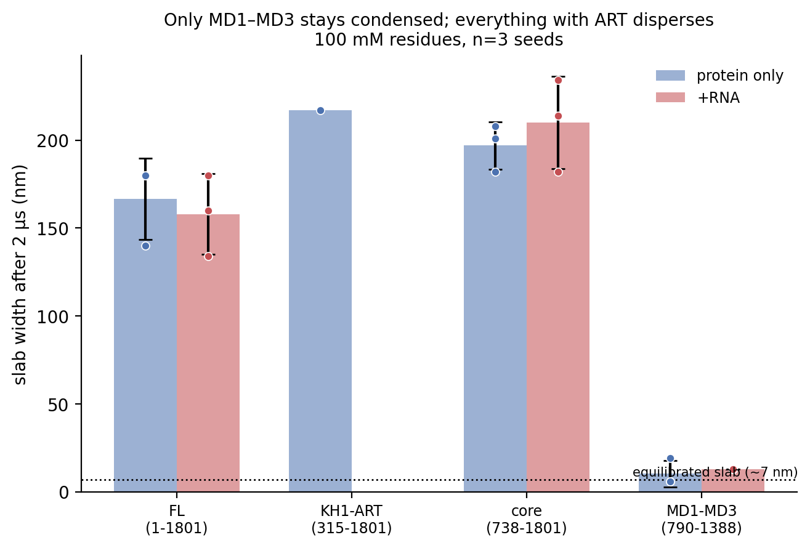
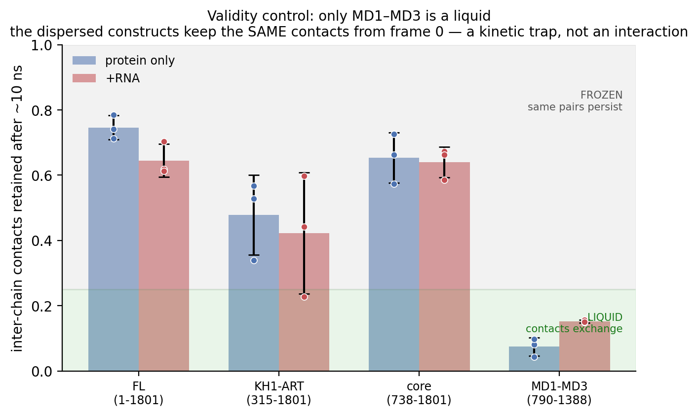
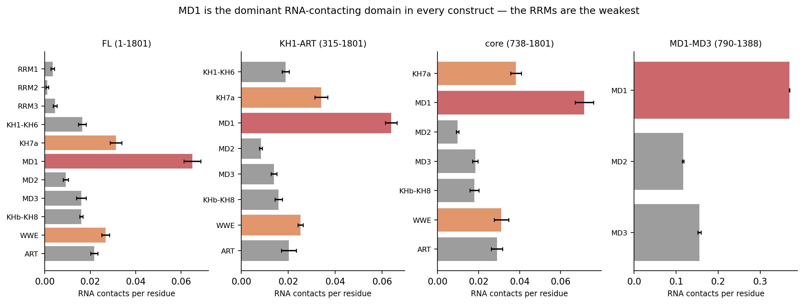
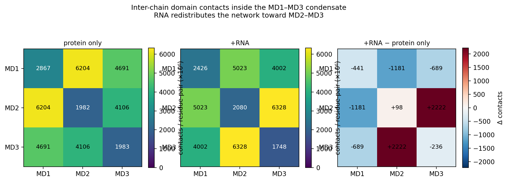

# Slab run 2 — results

24 runs, 4 constructs × 2 arms (±polyU40) × 3 paired seeds, all at **100 mM
residues**, 2 µs each, with the Phase 2.5 optimised restraints and the
141-pair KH7a–KHb bridge expanded across every chain copy.

Tables in `../analysis/`, figures in `../figures/rnapanel_*` (regenerate with
`python ../figure_rna_panel.py`). The four PNGs below are force-added despite
the repo's `figures/` ignore rule, so this summary renders on GitHub.

---

## 1. Condensation: only MD1–MD3 condenses, and RNA does not change that

Every system is compacted to a ~6–7 nm slab before production, then released.

| construct | FL span | protein only | +RNA | phase |
|---|---|---|---|---|
| `fl` | 1–1801 | 167 ± 23 nm | 158 ± 23 nm | dispersed |
| `kh1_art_full` | 315–1801 | 217 nm | — | dispersed |
| `core_full_go` | 738–1801 | 197 ± 13 nm | 210 ± 26 nm | dispersed |
| **`md_full`** | **790–1388** | **10 ± 8 nm** | **13 ± 0 nm** | **condensed** |

(final slab width after 2 µs; n=3 except `kh1_art_full`, see *Caveats*)

`md_full` holds its slab (6, 6, 19 nm protein-only; 13, 13, 13 nm +RNA) with
**c_sat = 0.0 mM — below detection**, i.e. essentially all protein in the dense
phase. Every construct containing ART disperses to 130–230 nm.

**RNA does not change whether anything condenses.** `fl` −9 nm and
`core_full_go` +13 nm, both < 1 pooled SD and in *opposite* directions.

> **Run 1's "RNA retards dispersal 1.67×, only when ART is present" does not
> reproduce.** That was one unreplicated cell, at uncontrolled concentration,
> without the KH bridge. With n=3, matched concentration and correct restraints
> the effect is absent.

`md_full` condensing is the positive control for the restraint changes: the
optimised restraints did **not** abolish phase separation, so the dispersal of
the ART-containing constructs is a property of those constructs, not an
artefact of the restraint set.

---

## 2. Validity control: only `md_full` is a liquid — read this before Section 4

A liquid condensate continuously re-partners. A kinetic trap keeps the same
contacts forever. Metric: fraction of inter-chain bead pairs still in contact
after ~10 ns.

| construct | protein only | +RNA | regime |
|---|---|---|---|
| `fl` | 0.746 ± 0.037 | 0.645 ± 0.051 | frozen |
| `kh1_art_full` | 0.478 ± 0.122 | 0.422 ± 0.186 | frozen |
| `core_full_go` | 0.654 ± 0.077 | 0.640 ± 0.047 | frozen |
| **`md_full`** | **0.074 ± 0.028** | **0.152 ± 0.004** | **liquid** |

**The dispersed constructs' inter-chain contacts are an initial condition, not
an interaction.** Traced directly in `fl`: MD2–ART inter-chain contacts are
6,796 at frame 0 and 6,295 at frame 1,999 — flat across 2 µs — while every
*other* inter-chain contact decays ~10×. 80% are literally the same bead pairs,
confined to 12 consecutive-index chain pairs (neighbours in the initial slab
placement). Extended multi-domain chains threaded through each other at the end
of equilibration cannot separate, because the restrained domains are rigid and
cannot pass through one another.

So the raw inter-chain contact map for `fl`, `kh1_art_full` and `core_full_go`
is dominated by leftover interpenetration and **must not** be read as domain
interaction preference. Only `md_full`'s map is interpretable.

### RNA makes the condensate less dynamic

`md_full` retention **doubles** with RNA: 0.074 → 0.152, a **2.04× increase
(3.9 pooled SD)**, with the +RNA arm extremely reproducible (SD 0.004). RNA
does not change *whether* it condenses, but it roughly halves the rate at which
the condensate re-partners — a more viscous, longer-lived contact network.
This is the clearest RNA effect in the whole panel.

---

## 3. Which domains touch the RNA: MD1 dominates, the RRMs are weakest

Contacts per domain residue per frame, 1.0 nm cutoff, +RNA arm only.

| rank | `fl` | `kh1_art_full` | `core_full_go` | `md_full` |
|---|---|---|---|---|
| 1 | **MD1** 0.065 | **MD1** 0.064 | **MD1** 0.072 | **MD1** 0.370 |
| 2 | KH7a 0.031 | KH7a 0.034 | KH7a 0.038 | MD3 0.156 |
| 3 | WWE 0.027 | WWE 0.025 | WWE 0.031 | MD2 0.117 |
| 4 | ART 0.022 | ART 0.020 | ART 0.029 | — |
| … | MD2 0.009 | MD2 0.008 | MD2 0.010 | — |
| last | **RRM2 0.001** | — | — | — |

**MD1 leads the next domain by ~1.9–2.4× per residue in every construct**, and
the ranking is identical in all 12 +RNA runs — MD1 rank 1, KH7a rank 2, WWE
rank 3, ART rank 4, with per-seed SDs of 3–6%.

Two things stand out:

* **The RRMs contact RNA least.** RRM1/2/3 sit at the bottom (0.5–2.1% of total
  RNA contact) despite being named RNA Recognition Motifs. **Caveat:** CALVADOS
  is one bead per residue with no base stacking and no sequence-specific
  recognition — contacts here are electrostatic and hydrophobic association
  only. This says the RRMs are not the most *electrostatically* RNA-attracting
  surfaces; it cannot speak to specific RRM-type binding, which the model
  cannot represent.
* **MD2 is consistently low** (4–5%) while MD1 is highest, even though both are
  macrodomains.

`md_full` shows ~5× higher absolute contact density than the dispersing
constructs simply because it is condensed — everything is near everything.

---

## 4. How domains compact: RNA competes MD1 away and the network shifts to MD2–MD3

Inter-chain contacts per residue-pair (×10⁶) inside the `md_full` condensate —
the only system Section 2 licenses us to interpret. Intra-chain contacts are
excluded, since those are fixed by the restraints.

| pair | protein only | +RNA | Δ |
|---|---|---|---|
| MD1–MD2 | 6204 | 5023 | **−1181** |
| MD2–MD3 | 4106 | 6328 | **+2222** |
| MD1–MD3 | 4691 | 4002 | −689 |
| MD1–MD1 | 2867 | 2426 | −441 |
| MD2–MD2 | 1982 | 2080 | +98 |
| MD3–MD3 | 1983 | 1748 | −236 |

Without RNA the network is organised around MD1: MD1–MD2 is the strongest pair,
and MD1 participates in the top three. **Adding RNA decreases every single MD1
pair** (−441, −1181, −689) while MD2–MD3 gains +2222 and becomes the dominant
interaction.

This is consistent with Section 3: MD1 is the top RNA-binding surface, RNA
occupies it, and the protein–protein network re-forms around MD2–MD3. RNA acts
as a **competitor for MD1**, not as a general crosslinker.

---

## Caveats

* **`kh1_art_full` c_sat is complete for 1 of 6 runs.** The other five
  `analyze_slab.py` jobs were still running at the time of writing (largest
  system in the panel). Its *dispersed* assignment is nonetheless supported by
  that run (217 nm) and by the frozen-contact signature in all six. The slab
  widths in Section 1 for this construct are therefore n=1.
* **Dispersal is measured as final slab width**, not a rate. Run 1's 1.67×
  claim was about a rate; a strictly like-for-like test would compare
  time-resolved dispersal profiles.
* **One concentration only** (100 mM residues). A construct that does not
  condense here may still have a c_sat above it.
* **CALVADOS RNA is a generic polyanion** — polyU40 with no base specificity.
  Conclusions are about charge/hydrophobicity-driven association.
* **The −WWE−ART tier is prepared but not run** (`fl_khb`, `kh1_khb`,
  `core_khb`, 18 runs, parked). It would test whether ART is specifically
  required for dispersal, which Section 1 makes the obvious next question:
  every construct that disperses contains ART, and the one that condenses
  does not.
